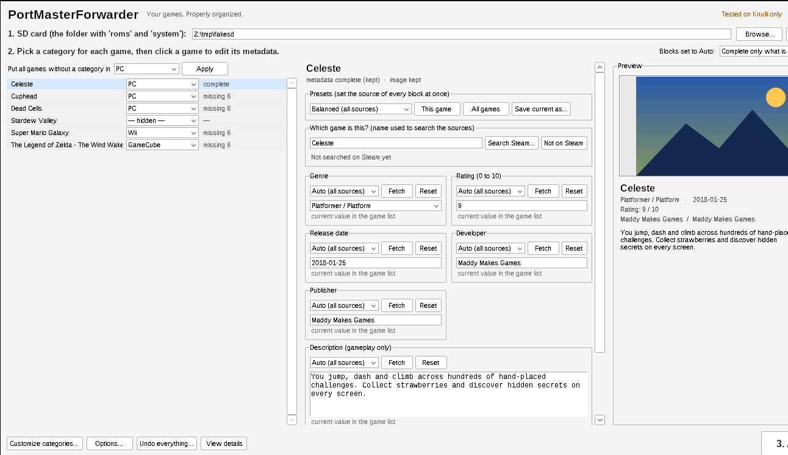

<p align="center">
  
</p>

<h1 align="center">PortMasterForwarder</h1>
<p align="center"><b>Your games. Properly organized.</b></p>

<p align="center">
  
  
  
  
  
  
</p>

> ## ⚠️ Compatibility notice - tested on Knulli only
> PortMasterForwarder was **developed and tested only on Knulli** (Anbernic RG35XX H).
> It has **not been tested** on other firmware (Batocera, ROCKNIX, muOS, ...) or on other devices.
> It may work on other EmulationStation-based systems, but nothing is guaranteed there - please use it at your own risk and
> **back up your SD card first**. If you try it elsewhere, a [compatibility report](.github/ISSUE_TEMPLATE/compatibility_report.md) is very welcome.
> Details: [docs/KNULLI.md](docs/KNULLI.md).

> ## ℹ️ Independent project - not affiliated with PortMaster
> **PortMasterForwarder is an independent, unofficial community project.** It is **not affiliated with, endorsed by, sponsored by or connected to the
> PortMaster project or its developers in any way.** The name only describes what the tool helps with: organizing games that are installed through
> PortMaster. It does not contain PortMaster code, does not modify PortMaster, and the PortMaster team is **not** responsible for it - please do not ask
> them for support with this tool; open an issue here instead. "PortMaster" belongs to its respective authors. If the PortMaster maintainers ever ask
> for the name to be changed, the project will be renamed. See [docs/INDEPENDENCE.md](docs/INDEPENDENCE.md).

PortMasterForwarder organizes **ports and adapted games** on EmulationStation-based handhelds. It creates your own menu categories
(GameCube, PlayStation 2, PC, Wii... or anything you define), links each game to its original PortMaster launcher **without copying files**,
and fills the game list with consistent genres, gameplay-focused descriptions, ratings and screenshots.

It does **not** install emulators and does **not** make games run on hardware that cannot run them: categories are only a way to *organize* games.

<p align="center"></p>

## Two editions, one core

| Edition | Where it runs | How to get it |
|---|---|---|
| **Gamepad edition** | **On the handheld**, from *Tools*, controlled with the console buttons (pygame) | `PortMasterForwarder-<version>-knulli.zip` - copy its `roms` folder to the SHARE partition ([guide](docs/GAMEPAD.md), [pt-BR](README.pt-BR.md)) |
| **Windows edition** | On your PC with the SD card inserted (tkinter, window with live preview) | `PortMasterForwarder.exe` from the [Releases](../../releases) page |

Both editions use the same rules and the same files on the card, so you can switch between them. The rest of this page describes the Windows edition;
the gamepad controls are in [docs/GAMEPAD.md](docs/GAMEPAD.md).

<p align="center"></p>

## Features

- **Your own categories** on the home screen (Art Book Next look). Create them on the fly from any game's category drop-down.
- **No duplicated files.** Each game gets a tiny launcher that runs the original `roms/ports` script, so PortMaster keeps working and updating.
- **Block editor with live preview.** Genre, rating, release date, developer, publisher, description and image are separate blocks, each with its own
  source (Steam, Wikipedia, RAWG, Google, AI, or your own value), a *Fetch* button and a preview of the result.
- **Presets** (Balanced, Steam, Wikipedia, RAWG, Google, AI evaluation, Keep current) and your own saved presets.
- **Consistent metadata:** exactly one genre from a fixed list of 15, gameplay-only descriptions in English, and a balanced rating (0-10 stored as 0.00-1.00).
- **Safe by design:** existing metadata is never silently overwritten, `gamelist.xml` is backed up, hand-made launchers are never touched, everything can be undone.
- **SD card detection**, game discovery, bulk category assignment, image management (Steam/RAWG thumbnails or your own files).
- **One shortcut per Minecraft (MCPE Launcher) version:** each version found in `roms/ports/mcpe_launcher/versions/` becomes its own entry that opens the game directly (needs the adapted launcher in [extras](extras/McpeLauncher.sh); see [docs/KNULLI.md](docs/KNULLI.md)). Can be switched off in *Options*.
- **Open source (MIT)**, no telemetry, no account.

## Download (Windows)

1. Go to the [**Releases**](../../releases) page and download `PortMasterForwarder.exe`.
2. (Optional) verify it against `PortMasterForwarder.exe.sha256` (`certutil -hashfile PortMasterForwarder.exe SHA256`).
3. Double-click it. No installation and no Python needed.

> **Windows SmartScreen / antivirus:** the executable is **not code-signed**, so Windows may show *"Windows protected your PC"* (click *More info > Run anyway*),
> and some antivirus tools flag PyInstaller programs by mistake. The source is fully open and the release is built by a public GitHub Actions workflow
> ([`release.yml`](.github/workflows/release.yml)); you can also [build it yourself](docs/BUILDING.md).

## Quick start

1. Put the SD card in your PC and start PortMasterForwarder. The card (the folder that contains `roms` and `system`) is detected automatically; otherwise click *Browse...*
2. **Step 2:** choose a category for each game in the list. *"Put all games without a category in..."* does it in one click. Choose **+ New category...** to create one.
3. Click a game to edit its metadata **next to the list**: fetch blocks one by one, type your own values, or apply a preset. The preview on the right shows the result.
4. **Step 3:** click **APPLY**, eject the card and restart Knulli (*Menu > Quit > Restart System*).

### Run from source

```bash
git clone <repository-url>
cd PortMasterForwarder
python -m pip install -r requirements.txt
PYTHONPATH=src python -m portmasterforwarder        # Windows: run_from_source.bat
```

## The editor

The window has the **game list** (left), the **metadata blocks** of the selected game (middle) and a live **preview** (right).

| Block | What you can do |
|---|---|
| **Source** (every block) | *Auto* (all sources), *Steam*, *Wikipedia*, *RAWG*, *Google*, *AI evaluation*, or *Keep current* |
| **Fetch** | Gets only that block from the chosen source and fills it immediately (the value becomes *pinned*) |
| **Your own value** | Type or pick a value; it is pinned and written on APPLY. *Reset* drops it |
| **Image** | Choose Steam or RAWG and *Fetch* to click a thumbnail, or *Browse...* for a file from your computer |
| **Presets** | Set the source of all blocks at once for one game or all games; *Save current as...* stores your own |

Blocks left on **Auto** follow the global option *Complete only what is missing* (default - games that already have metadata are not changed) or *Replace everything*.
A block with an explicit source or your own value always wins; *Keep current* is never touched.

## Metadata rules

- **Genre:** exactly one of `Action`, `Platformer / Platform`, `Adventure`, `RPG (Role-Playing Game)`, `Shooter / Shmup`, `Fighting`, `Beat 'em Up`,
  `Racing / Driving`, `Sports`, `Puzzle`, `Strategy`, `Simulation`, `Pinball`, `Card Game / Board Game`, `Music / Rhythm`. If the evidence is weak the genre stays empty.
- **Description:** English, 2-4 sentences, only what the game is like to play. Platform, release/franchise history, technical, story and marketing sentences are filtered out; nothing is invented.
- **Rating:** a balanced 0-10 estimate from several signals (never a plain copy of one score), or an optional AI evaluation. No score is written when the evidence is thin.

Full details and formulas: [docs/METADATA_RULES.md](docs/METADATA_RULES.md).

## What PortMasterForwarder changes on the card

| Path | Purpose |
|---|---|
| `roms/<category>/<game>.sh` | Launcher that runs the original script in `roms/ports` |
| `roms/<category>/gamelist.xml` + `images/` | Metadata and screenshots (`gamelist.xml.bak` = state before the first change, if the file existed) |
| `system/configs/emulationstation/es_systems_<category>.cfg` | The menu systems |

`roms/ports`, PortMaster and the original systems are never modified. **Undo everything...** removes the launchers and systems PortMasterForwarder created.

## Information sources, privacy and licenses

Steam, Wikipedia/Wikidata (no key), RAWG (free key) and Google Programmable Search (key + engine ID) are optional and can be switched off.
An optional AI evaluation uses *your own* Anthropic API key. There is no telemetry; nothing is sent anywhere except the lookups you enable.
API keys are stored **in plain text** in `%APPDATA%\PortMasterForwarder\portmasterforwarder.json` - do not share that file.
Third-party content (Wikipedia text is CC BY-SA, game descriptions belong to their publishers, RAWG requires attribution) is covered in
[THIRD_PARTY_NOTICES.md](THIRD_PARTY_NOTICES.md). Please respect each service's terms.

## Known limitations

- **Tested on Knulli only** (see the notice above).
- Network integrations were developed against documented APIs and simulated responses; real services can change.
- Wikipedia lookups can pick the wrong article for very generic titles (use *Fetch* and check the preview).
- Games not on Steam get no automatic image unless a RAWG key is set (or you pick an image from your computer).
- The genre list contains `/` characters; EmulationStation filters may treat them as separators (not verified).
- The `.exe` is not code-signed.

## Documentation

- [Architecture](docs/ARCHITECTURE.md) - modules, data flow, how to extend
- [Metadata rules](docs/METADATA_RULES.md) - genres, descriptions, ratings
- [Independence statement](docs/INDEPENDENCE.md) - [Knulli notes](docs/KNULLI.md) - what was verified, how it works, how to undo
- [Building the .exe](docs/BUILDING.md) and [releasing](docs/RELEASING.md)
- [Contributing](CONTRIBUTING.md) - [Code of Conduct](CODE_OF_CONDUCT.md) - [Security](SECURITY.md) - [Changelog](CHANGELOG.md)

## Disclaimer

PortMasterForwarder is free software provided **"as is"**, without warranty (see [LICENSE](LICENSE)). It is an **independent project and has nothing to do with the
PortMaster project** (see the notice at the top). It is also **not affiliated with or endorsed by**
Knulli, Batocera, Anbernic, Valve (Steam), Nintendo, Sony, Wikimedia, RAWG, Google or Anthropic. All product and company names are
trademarks of their respective owners and are used only to describe compatibility. PortMasterForwarder does not distribute games, ROMs or copyrighted game files.

## License

[MIT](LICENSE) (c) 2026 PortMasterForwarder contributors.
