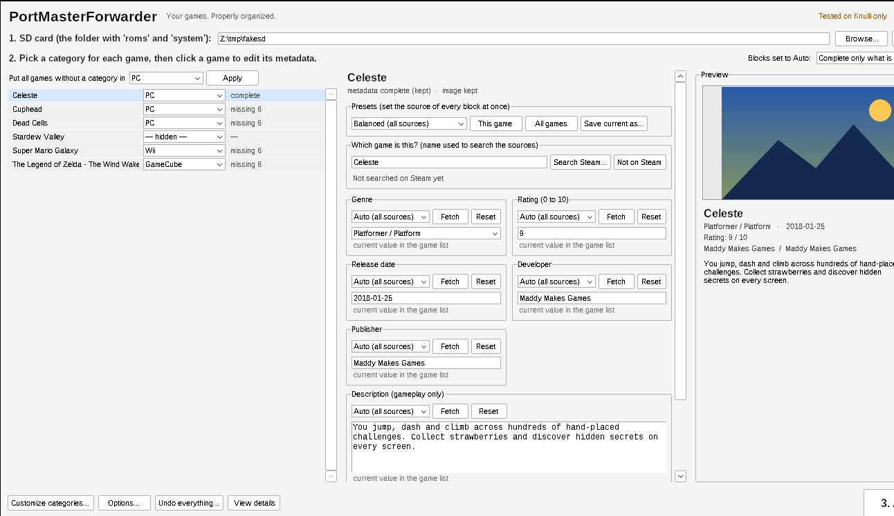

# Gamepad edition (runs on the handheld)

> Developed and tested on **Knulli only** (Anbernic RG35XX H). Independent project, **not affiliated with PortMaster**.

PortMasterForwarder runs from **Tools** on the console and is controlled **entirely with the console buttons** - no PC and no SD card swapping.

## Install
1. Download `PortMasterForwarder-<version>-knulli.zip` from the [Releases](../../releases) page (or build it: `bash scripts/build_release.sh`).
2. Unzip it and copy the **`roms`** folder onto the **SHARE** partition of the SD card (merge when asked).
3. On the console: *Menu > Game Settings > Update Gamelists*. **PortMasterForwarder** appears under **Tools**.

Python 3 with **pygame** is needed on the device. Knulli ships it; otherwise the launcher falls back to the copy bundled with PortMaster's `pylibs`
(PortMasterForwarder only *uses* that copy - it does not modify or redistribute PortMaster).

## Controls
| Where | Buttons |
|---|---|
| Game list | **Left/Right** category - **A** edit game - **X** new category - **Y** fill empty - **START** menu - **L/R** page |
| Game screen | **Up/Down** row - **Left/Right** change source/preset - **A** fetch / apply - **X** type value - **Y** clear - **START** save only this game - **B** back |
| Keyboard | **A** type - **X** delete - **Y** space - **START** done - **B** cancel |

"A" is the east button (like EmulationStation). If yours is reversed use *Menu > Swap A/B*.

**START > Edit categories** renames a category and changes its icon (the folder never changes, so shortcuts keep working). **START** on a game screen saves
just that game and *rewrites* its metadata with what you typed or fetched; the global **APPLY** only fills gaps. The left stick also navigates.

## Quick start
1. Pick a category for each game with Left/Right (or **Y** to fill all empty ones).
2. Press **A** on a game to fetch or type metadata block by block.
3. **START > APPLY**. The menus are installed and EmulationStation reloads; if a category does not show, restart (*Menu > Quit > Restart System*).

Category folders you already created (for example `portandroid`) are discovered automatically; hand-made shortcuts count as categorized and are never overwritten.
Settings and the log live in `roms/tools/PortMasterForwarder/data/`.

## Optional: one shortcut per Minecraft (MCPE Launcher) version
Copy `roms/tools/PortMasterForwarder/extras/McpeLauncher.sh` to `roms/ports/` (replace your old one; keep that exact name). Every folder in
`roms/ports/mcpe_launcher/versions/` then gets a **"Minecraft <version>"** shortcut that skips the menu. See [KNULLI.md](KNULLI.md).

